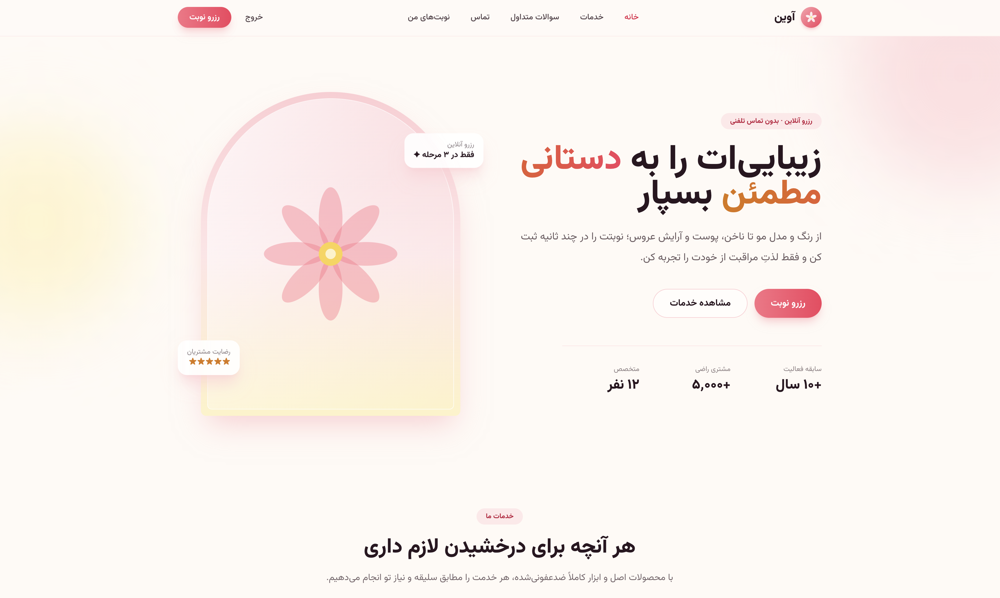
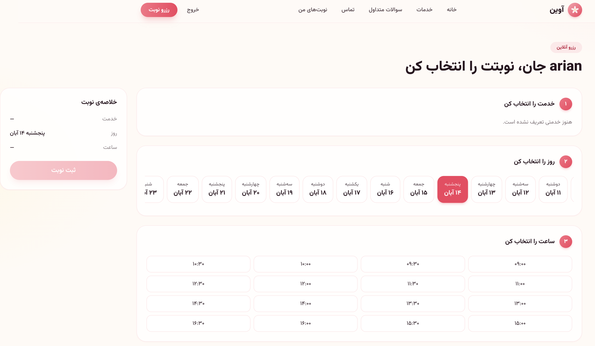

<div align="center">

# Reservia — Beauty Salon Booking Platform

A modern beauty salon website with a simple online appointment booking experience.

**Django · Tailwind CSS · React · PostgreSQL · Docker**

[Features](#-features) · [Screenshots](#-screenshots) · [Tech Stack](#-tech-stack) · [Getting Started](#-getting-started) · [Security](#-security)

</div>

---

## ✨ Overview

Reservia is a beauty salon website that lets customers explore salon services and book appointments online. The main website is built with Django HTML templates and Tailwind CSS, while React is used only for the appointment booking page.

The project uses PostgreSQL for data storage and Docker Compose for containerized development and deployment.

## 📸 Screenshots

### Homepage

The salon landing page introduces the brand, highlights its services, and guides visitors toward making an appointment.



### Online appointment booking

The booking flow guides the customer through selecting a service, choosing a date, and selecting an available time slot.



## 🚀 Features

- Beauty salon landing page and service pages.
- Online appointment booking interface.
- Booking experience powered by React on the `/book/` page only.
- User registration and login.
- Customer appointment list and cancellation.
- Jalali date filtering.
- Django admin panel for site management.
- Demo service seeding command.

## 🧰 Tech Stack

| Technology | Usage |
|---|---|
| Django | Backend, HTML templates, views, authentication |
| Tailwind CSS | Styling and responsive UI |
| React | Interactive booking page only |
| PostgreSQL | Database |
| Docker Compose | Containerized application services |
| Caddy | HTTPS reverse proxy in production |

## 🗂️ Project Structure

```text
.
├── backend/
│   ├── templates/       # Django HTML pages styled with Tailwind
│   ├── web/             # Views, auth forms, Jalali date filtering
│   ├── booking/         # Booking models and API
│   └── ...
├── frontend/
│   └── src/
│       ├── styles.css   # Tailwind entry point
│       └── Booking.jsx  # React booking interface
├── docker-compose.yml
├── Dockerfile
└── .env.example
```

Most of the site's visual UI is implemented in `backend/templates/`. The frontend build generates two files:

- `style.css` — styles used across the website.
- `islands.js` — React booking interface loaded only on `/book/`.

## 🏁 Getting Started

### Requirements

- Docker and Docker Compose
- Git

### Run with Docker

1. Clone the repository:

   ```bash
   git clone https://github.com/Arian-Zf/Reservia.git
   cd Reservia
   ```

2. Create your environment file:

   ```bash
   cp .env.example .env
   ```

   Update the `SECRET_KEY` and database password in `.env` before running the application.

3. Build and start the services:

   ```bash
   docker compose up -d --build --remove-orphans
   ```

4. Create an admin user:

   ```bash
   docker compose exec backend python manage.py createsuperuser
   ```

5. (Optional) Load sample services:

   ```bash
   docker compose exec backend python manage.py seed_demo
   ```

The application will be available at:

- Website: <http://localhost>
- Admin panel: <http://localhost/admin/>

## 💻 Local Development Without Docker

Run the frontend watcher in the first terminal:

```bash
cd frontend
npm install
npm run watch
```

In a second terminal, install backend dependencies and start Django:

```bash
cd backend
pip install -r requirements.txt

export DJANGO_DEBUG=true
python manage.py migrate
python manage.py runserver
```

## 🔐 Production Deployment (HTTPS)

For production, bind the application port to localhost in `docker-compose.yml`:

```yaml
127.0.0.1:8000:8000
```

Then place Caddy in front of the application:

```caddy
yourdomain.com {
    reverse_proxy localhost:8000
}
```

Configure the following values in `.env`:

```env
DJANGO_HTTPS=true
DJANGO_ALLOWED_HOSTS=yourdomain.com
DJANGO_CSRF_TRUSTED_ORIGINS=https://yourdomain.com
DRF_NUM_PROXIES=1
DJANGO_HSTS_SECONDS=31536000
```

Set `DJANGO_HSTS_SECONDS` only after confirming that HTTPS is working correctly.

## 🛡️ Security

- Session-based authentication with HttpOnly and Secure cookies.
- CSRF protection on forms and API endpoints.
- Strict Content Security Policy (CSP), with no inline scripts or styles and no external CDNs.
- Self-hosted fonts.
- Rate limiting for login, registration, and booking attempts.
- Customers can view and cancel only their own appointments.
- Database `UniqueConstraint` prevents duplicate bookings for the same time slot.
- Containers run as a non-root user.

## 🛣️ Future Improvements

- Redis-based rate limiting.
- SMS appointment reminders.
- Multiple service providers and staff members.
- Portfolio gallery with image uploads.
- Automated database backups.

---

<div align="center">

Made with care for a better salon booking experience.

</div>
